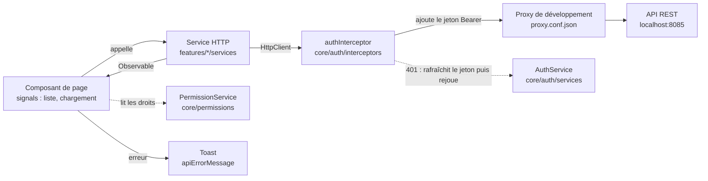

# Architecture

Cette page explique comment le code du front-end est organisé et pourquoi. Elle s'adresse aux développeurs qui vont modifier un module existant ou en créer un.

## Arborescence

```text
src/
├── main.ts                  Démarrage de l'application
├── app.config.ts            Fournisseurs globaux : routeur, client HTTP, thème PrimeNG
├── app.routes.ts            Routes racines : /apply, /auth, shell applicatif
├── environments/            Configuration par environnement (voir Installation)
└── app/
    ├── core/                Services et mécanismes globaux
    │   ├── auth/            Connexion, session, intercepteur HTTP, guards
    │   ├── config/          Identité visuelle (app-brand.ts)
    │   ├── modules/         Registre des modules (AppFeature)
    │   ├── navigation/      Page « introuvable »
    │   ├── permissions/     Autorités, portées, guard et service de permissions
    │   ├── services/        Pipe FirstCharPipe
    │   └── settings/        Shell des Paramètres et paramètres système
    ├── shared/              Éléments réutilisables sans logique métier
    │   ├── data-table/      Colonnes, recherche, filtres et barre d'outils des listes
    │   ├── export/          Impression et export PDF et Excel
    │   ├── import/          Import d'une liste depuis un classeur Excel
    │   ├── http/            Erreurs d'API, paramètres de requête, textes lisibles
    │   ├── models/          Forme paginée commune (PagedResponse)
    │   ├── navigation/      Retour arrière, navigation entre fiches
    │   ├── ui/              En-tête de page, cartes du tableau de bord, styles partagés
    │   └── utils/           URL d'avatar, URL signées
    ├── features/            Modules métier
    │   ├── academic/
    │   ├── admission/
    │   ├── identity/
    │   └── scheduling/
    ├── layout/              Shell applicatif : barre supérieure, menu latéral, pied de page
    └── pages/
        └── dashboard/       Tableau de bord, alimenté par les widgets des modules
```

Le registre des modules se trouve dans `core/modules`.

### Structure d'un module

Exemple avec le module Planification :

```text
features/scheduling/
├── scheduling.feature.ts      Déclaration AppFeature : routes, menu, onglet de Paramètres
├── scheduling.public-api.ts   Éléments exposés aux autres modules
├── models/                    Types de l'API et fonctions d'affichage
├── services/                  Services HTTP
├── permissions/               Autorités du module
├── settings/                  Pages et routes montées sous /settings/scheduling
│   ├── routes.ts
│   └── pages/rooms/
└── timetable/                 Sous-domaine Horaires, avec ses propres pages, services et routes
```

Les autres modules ajoutent, selon leurs besoins, des dossiers `components/`, `pages/`, `dashboard/` ou `utils/`.

## Principes appliqués

| Principe | Application dans le code |
|---|---|
| Découpage par fonctionnalité | Chaque domaine métier vit dans `features/<module>/` et se déclare dans le registre. |
| Composants standalone | Tous les composants sont standalone ; le projet ne contient aucun `NgModule`. |
| Injection par `inject()` | Aucun service n'est injecté par le constructeur. |
| État par signals | L'état local et partagé repose sur `signal()` et `computed()`. Le projet n'utilise pas `BehaviorSubject`. RxJS sert aux appels HTTP. |
| Entrées par signals | Les composants déclarent leurs entrées avec `input()`, jamais avec `@Input`. |
| Sans Zone.js | `provideZonelessChangeDetection()` dans `src/app.config.ts`. Une vue se met à jour quand un signal qu'elle lit change. |
| Chargement différé | Chaque module charge ses routes avec `loadChildren` ou `loadComponent`. Les bibliothèques d'export sont importées au premier usage. |
| Droits déclaratifs | Routes, entrées de menu, onglets, widgets et actions portent leurs `permissions` ; le code central les filtre. |
| Frontières entre modules | Un module qui utilise une ressource d'un autre module importe son fichier `*.public-api.ts`, pas un chemin interne. |

`ChangeDetectionStrategy.OnPush` est déclaré dans une partie des composants, par exemple `features/scheduling/settings/pages/rooms/rooms.ts`. Déclarez-le dans tout nouveau composant.

L'alias `@/` désigne le dossier `src/` (`tsconfig.json`). Écrivez par exemple `@/app/shared/http/api-error`.

## Flux d'un appel à l'API

Le schéma suivant montre le trajet d'une donnée, de l'écran à l'API.



1. Le composant appelle une méthode du service et s'abonne au résultat.
2. Le service construit la requête avec `HttpClient` et l'URL `${environment.apiBaseUrl}/api/v1/<ressource>`.
3. L'intercepteur ajoute le jeton d'accès. Sur une réponse 401, il rafraîchit la session puis rejoue la requête.
4. Le composant range la réponse dans un signal ; la vue se met à jour.
5. En cas d'erreur, le composant affiche un toast.

Le détail de chaque étape est dans [Communication avec le backend](communication-backend.md).

## Registre des modules

Le registre relie les modules au reste de l'application. Il se compose de deux fichiers.

`core/modules/app-feature.model.ts` définit l'interface `AppFeature`. Un module y déclare :

| Propriété | Rôle |
|---|---|
| `key`, `label`, `order` | Identité du module et ordre d'affichage |
| `route` | Routes opérationnelles, montées à la racine du shell (`/scheduling`) |
| `menu` | Entrées du menu latéral, avec leurs autorités |
| `settingsTab` | Onglet du module dans les Paramètres, avec ses liens secondaires |
| `settingsRoute` | Routes montées sous `/settings/<path>` |
| `dashboardWidgets` | Widgets ajoutés au tableau de bord |

`core/modules/app-feature.registry.ts` liste les modules et en dérive ce que consomme le reste de l'application :

```ts
// src/app/core/modules/app-feature.registry.ts
export const appFeatures: AppFeature[] = [
    coreSystemFeature,
    identityFeature,
    academicFeature,
    schedulingFeature,
    admissionFeature
].sort(byOrder);
```

| Export | Consommé par |
|---|---|
| `appFeatureRoutes` | `src/app.routes.ts`, enfants du shell applicatif |
| `appMenuItems` | `layout/component/app.menu.ts` |
| `appSettingsTabs` | `core/settings/pages/settings-shell/settings-shell.ts` et le menu |
| `appSettingsChildRoutes` | `core/settings/routes.ts` |
| `appDashboardWidgets` | `pages/dashboard/dashboard.widgets.ts` |

Ajouter un module revient donc à écrire son `*.feature.ts` et à l'ajouter au tableau `appFeatures`. Le [démarrage rapide](creer-un-module.md) construit un module complet de cette façon ; [Brancher un module](brancher-un-module.md) détaille chaque propriété.

## Navigation

Le menu latéral est construit dans `layout/component/app.menu.ts`. Il contient, dans l'ordre :

1. l'entrée « Tableau de bord » ;
2. les entrées `menu` de chaque module, triées par `order` ;
3. l'entrée « Paramètres », seulement si l'utilisateur peut ouvrir au moins un onglet de Paramètres.

Le menu masque toute entrée dont l'utilisateur n'a pas les `permissions`, ou dont il détient les `hiddenWhenPermissions`. Ce second mécanisme sert à masquer une vue personnelle pour un gestionnaire, par exemple « Mon horaire » pour qui gère les horaires (`features/scheduling/scheduling.feature.ts`).

Les Paramètres (`/settings`) sont un shell à onglets (`core/settings/pages/settings-shell/`). Chaque module y fournit son onglet et ses routes. La route `/settings` redirige vers `/settings/identity`.

## Conventions de nommage

Le code applique les règles suivantes.

| Élément | Règle | Exemple |
|---|---|---|
| Fichiers | kebab-case, sans suffixe `.component` | `rooms.ts`, `room.service.ts` |
| Composant | Classe en PascalCase ; le suffixe `Page` est présent sur certaines pages seulement | `RoomsPage`, `UserDetail` |
| Sélecteur | Préfixe `app-` | `app-scheduling-rooms`, `app-content-subtopbar` |
| Directive | Préfixe `app`, en camelCase (règle ESLint) | — |
| Service | Suffixe `Service` | `RoomService` |
| Déclaration de module | `<module>Feature` | `schedulingFeature` |
| Autorités | Objet `<Module>Permission` en `as const` | `SchedulingPermission.RoomUpdateAll` |
| Routes | Export par défaut d'un fichier `routes.ts`, ou tableau nommé | `export default [...]`, `identityAdminRoutes` |
| Tests | Fichier `.spec.ts` à côté du fichier testé | `room.service.spec.ts` |
| API publique d'un module | `<module>.public-api.ts` | `scheduling.public-api.ts` |

## Éléments partagés

Réutilisez ces éléments avant d'en écrire de nouveaux.

| Élément | Rôle | Exemple d'utilisation |
|---|---|---|
| `shared/ui/content-subtopbar/` (`ContentSubtopbar`) | En-tête de page : surtitre, titre, actions. Une action porteuse de `permissions` est masquée si l'utilisateur ne les a pas. | `features/scheduling/settings/pages/rooms/rooms.html` |
| `shared/ui/dashboard/dashboard-card/` (`DashboardCard`) | Cadre d'un widget du tableau de bord | `features/identity/dashboard/components/repartition_users.ts` |
| `shared/ui/dashboard/dashboard-stat-card/` (`DashboardStatCard`) | Carte de statistique du tableau de bord | `features/academic/dashboard/components/faculty-stats-widget.ts` |
| `shared/data-table/column.model.ts` (`ColumnDef<T>`) | Description des colonnes d'une liste, déclarée une seule fois : affichage, recherche, filtres, export et import la lisent | `features/scheduling/settings/pages/rooms/rooms.ts` (`ROOM_COLUMNS`) |
| `shared/data-table/data-filter/` (`DataFilter`) | Recherche, filtres avancés et tri d'une liste | `features/scheduling/settings/pages/rooms/rooms.html` |
| `shared/data-table/table-toolbar/` (`TableToolbar`) | Boutons « Imprimer », « Exporter en Excel », « Actualiser » et, si l'écran fournit un `importConfig`, « Importer » | `features/scheduling/settings/pages/rooms/rooms.html` |
| `shared/data-table/table-query.ts` (`applyQuery`) | Applique la recherche, les filtres et le tri aux lignes chargées | `features/scheduling/settings/pages/rooms/rooms.ts` |
| `shared/export/` (`EXPORT_SERVICE`, `provideExport`) | Impression et export PDF et Excel, indépendants de la bibliothèque utilisée | `features/scheduling/timetable/services/timetable-export.service.ts` |
| `shared/import/` (`ImportConfig`, `ImportDialog`) | Import d'une liste depuis un classeur Excel, avec un modèle à télécharger | `features/scheduling/settings/pages/rooms/rooms.ts` |
| `shared/ui/styles/_stacked-table.scss` | Affichage des tableaux en cartes empilées sur petit écran, avec la classe `stack-table` | `features/academic/pages/course-list/course-list.scss` |
| `shared/http/api-error.ts` | `apiErrorMessage` : message d'erreur lisible pour un toast. `apiInvalidFields` : erreurs de validation par champ. | `features/scheduling/settings/pages/rooms/rooms.ts` |
| `shared/http/api-params.ts` (`toApiParams`) | Paramètres de requête en snake_case, valeurs vides omises | `features/academic/services/course.service.ts` |
| `shared/http/readable-api-text.ts` (`readableApiText`) | Retire les identifiants techniques d'un texte et écrit les dates en français | `features/scheduling/settings/pages/rooms/rooms.ts` |
| `shared/models/paged-response.model.ts` (`PagedResponse<T>`) | Forme d'une réponse paginée | Recommandé pour tout nouveau module |
| `shared/navigation/go-back.ts` (`goBack`) | Retour à l'écran précédent, avec une route de repli | `core/settings/pages/system-settings/system-settings.ts` |
| `shared/navigation/detail-navigation.service.ts` (`DetailNavigationService`) | Fiche précédente ou suivante depuis une fiche de détail, à partir de la liste d'origine | `features/academic/pages/course-detail/course-detail.ts` |
| `shared/utils/avatar-url.ts` | URL complète d'un avatar | `layout/component/app.topbar.ts` |
| `shared/utils/signed-url.ts` | Détecte une URL signée expirée ou proche de l'expiration | `features/admission/components/candidate-dossier/dossier-document-urls.ts` |
| `core/services/Pipes.ts` (`FirstCharPipe`) | Première lettre en majuscule | Aucun usage actuel |

!!! note
    `apiInvalidFields` n'est utilisé par aucun écran pour l'instant. Le module Académique déclare sa propre copie de `PagedResponse` dans `features/academic/models/academic-reference.model.ts`. Pour un nouveau module, utilisez la version de `shared/models/`.
