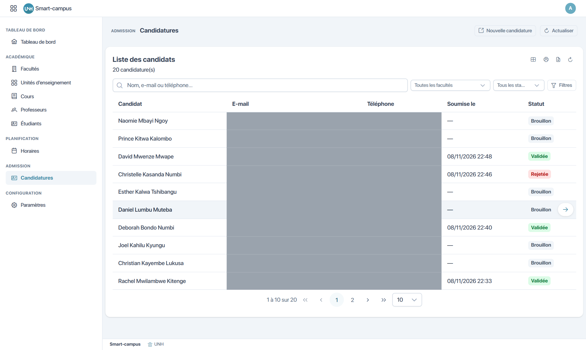
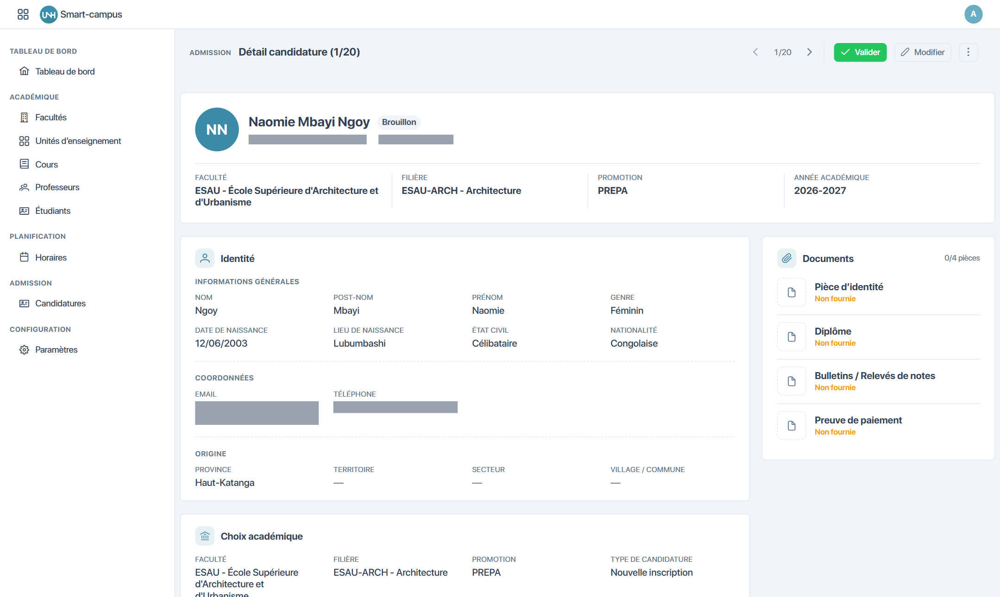
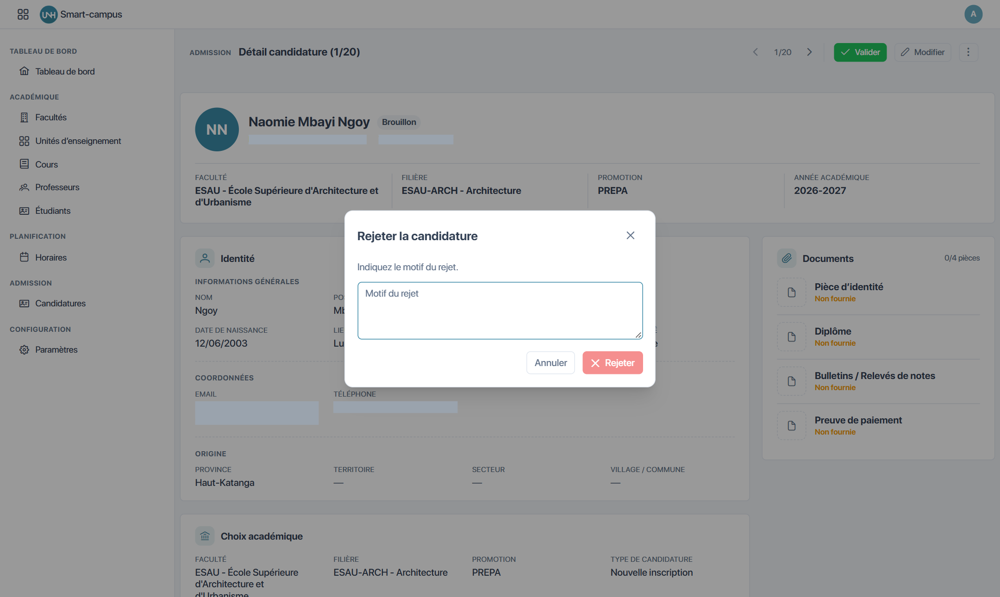
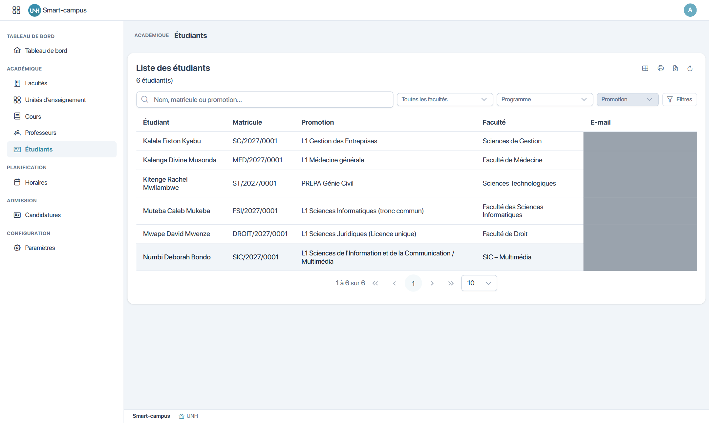

# Candidatures et étudiants

Cette page explique comment examiner les candidatures, les valider ou les rejeter, puis retrouver les étudiants.

**Profils concernés :** Administrateur, Secrétaire académique.

Le parcours vu du côté du candidat est décrit dans [Parcours candidat et étudiant](parcours-candidat-etudiant.md). Les statuts d'une candidature y sont détaillés.

## La liste des candidatures

Menu **Admission › Candidatures**.

La **Liste des candidats** affiche par défaut **Candidat**, **E-mail**, **Téléphone**, **Soumise le** et **Statut**. Le bouton **Colonnes** ajoute ou retire des colonnes, par exemple **Genre**. Le champ de recherche accepte un nom, un e-mail ou un téléphone. Le nombre de candidatures affichées est indiqué au-dessus du tableau.

Pour restreindre la liste :

- **Toutes les facultés** : choisissez une faculté ;
- **Tous les statuts** : choisissez **Brouillon**, **En attente**, **Validée**, **Rejetée** ou **Annulée** ;
- **Rechercher…** et **Filtres** : voir [Travailler avec les listes](prise-en-main.md#travailler-avec-les-listes).

Le bouton **Nouvelle candidature** ouvre le formulaire public de pré-inscription dans un nouvel onglet. Il sert à saisir une candidature pour le compte d'une personne.

## Examiner une candidature

1. Dans la liste, cliquez sur la ligne de la candidature.
2. La fiche affiche le dossier complet et les **Documents** déposés, avec le compteur de pièces.
3. Cliquez sur un document pour le prévisualiser. **Ouvrir dans un nouvel onglet** l'affiche en grand.

**Précédent** et **Suivant**, en haut de la fiche, passent à la candidature voisine dans la liste. La position est affichée entre les deux, par exemple « 3/42 ».

## Valider une candidature

1. Ouvrez la fiche de la candidature.
2. Cliquez sur **Valider**.
3. Confirmez. Si le dossier est encore au statut **Brouillon**, la confirmation vous prévient que les documents sont peut-être incomplets.

**Résultat attendu :** le message « Candidature validée avec succès. » s'affiche, et le statut passe à **Validée**. Ensuite, automatiquement :

- une fiche étudiant est créée, avec un matricule ;
- le compte de la personne reçoit le profil **Étudiant** ;
- la personne est prévenue par e-mail.

La fiche étudiant apparaît dans **Académique › Étudiants**.

## Rejeter une candidature

1. Ouvrez la fiche de la candidature.
2. Cliquez sur le bouton **Autres actions** (⋮), en haut à droite, puis sur **Rejeter**.
3. Dans **Motif du rejet**, indiquez la raison. Le motif est obligatoire, 500 caractères au plus.
4. Cliquez sur **Rejeter**.

**Résultat attendu :** le message « Candidature rejetée avec succès. » s'affiche, et le statut passe à **Rejetée**. La personne reçoit un e-mail avec le motif.

## Corriger un dossier

1. Ouvrez la fiche de la candidature.
2. Cliquez sur **Modifier**.
3. Corrigez les champs.
4. Cliquez sur **Enregistrer**, ou sur **Annuler** pour abandonner.

**Résultat attendu :** le message « Dossier du candidat mis à jour. » s'affiche.

**Valider**, **Rejeter** et **Modifier** ne sont disponibles qu'aux statuts **Brouillon** et **En attente**. Une candidature validée ou rejetée ne peut plus être modifiée.

## Les étudiants

Menu **Académique › Étudiants**.

La **Liste des étudiants** affiche par défaut **Étudiant**, **Matricule**, **Promotion**, **Faculté** et **E-mail**. Le bouton **Colonnes** ajoute par exemple **Genre**, **Nationalité** ou **Téléphone**. La recherche accepte un nom, un matricule ou une promotion. Restreignez la liste avec **Toutes les facultés**, **Programme** et **Promotion**. Les boutons **Imprimer** et **Exporter en Excel** reprennent la liste affichée.

Si la base compte beaucoup d'étudiants, seuls les premiers sont chargés. Un message l'indique : choisissez alors une faculté, un programme ou une promotion.

### Modifier une fiche étudiant

1. Dans la liste, cliquez sur l'étudiant.
2. La fiche présente les **Informations personnelles**, le **Parcours académique** et la partie **Famille et urgence**.
3. Cliquez sur **Modifier**, corrigez, puis cliquez sur **Enregistrer**.

**Résultat attendu :** le message « Étudiant modifié. » s'affiche.

## Erreurs fréquentes

| Message | Cause | Que faire |
|---|---|---|
| « Le motif de rejet est obligatoire. » | Le motif est vide. | Saisissez un motif. |
| « Le motif ne peut pas dépasser 500 caractères. » | Le motif est trop long. | Raccourcissez-le. |
| « Impossible de valider la candidature. » | Le serveur a refusé la validation, par exemple parce qu'elle a déjà été validée. | Cliquez sur **Liste**, actualisez, puis rouvrez la fiche. |
| **Candidature introuvable** | Elle a peut-être été supprimée, ou n'est pas dans votre périmètre : chaque profil ne voit que les candidatures auxquelles ses droits donnent accès. | Revenez à la liste et actualisez-la. Si la candidature doit vous être accessible, contactez un administrateur. |
| « Formulaire incomplet » | Un champ obligatoire du dossier est vide. | Complétez les champs signalés. |
