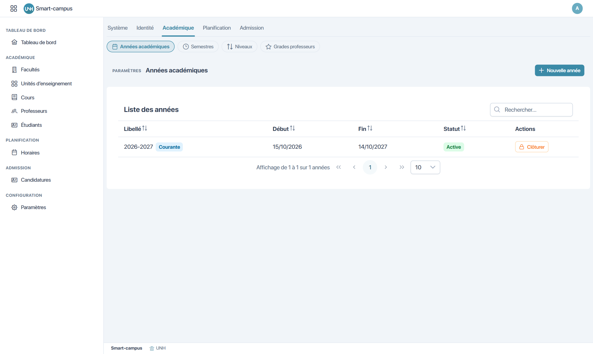
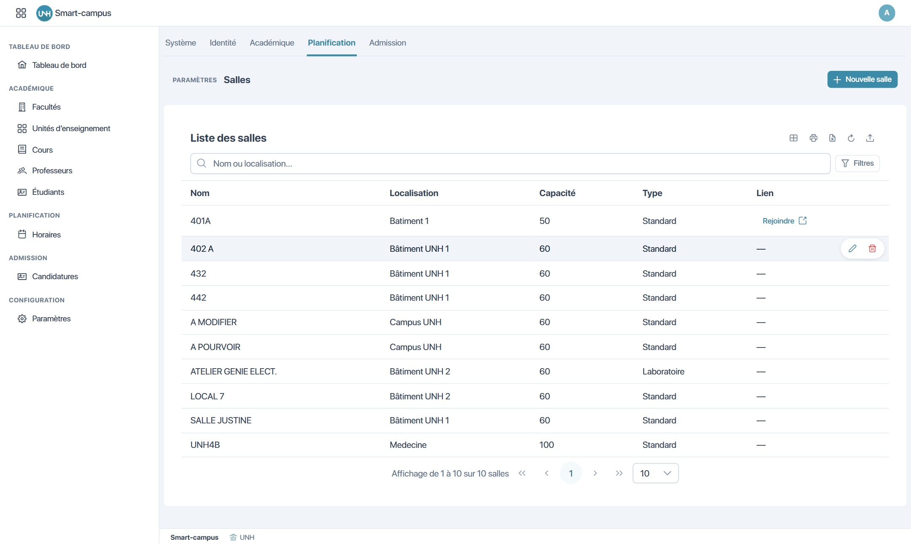

# Configuration

Cette page décrit les réglages de l'application : système, année académique, semestres, niveaux, grades, inscriptions et salles.

**Profils concernés :** Administrateur. Le Secrétaire académique accède aux onglets **Système** et **Identité** dans la configuration actuelle.

## Ouvrir les paramètres

Menu **Configuration › Paramètres**. L'écran s'ouvre sur le premier onglet auquel votre profil a accès.

| Onglet | Écrans | Profils |
|---|---|---|
| **Système** | Paramètres système | Administrateur, Secrétaire académique |
| **Identité** | Utilisateurs, Profils métier, Rôles, Privilèges : voir [Utilisateurs, profils et droits](utilisateurs-droits.md) | Administrateur, Secrétaire académique |
| **Académique** | Années académiques, Semestres, Niveaux, Grades professeurs | Administrateur |
| **Admission** | Activation | Administrateur |
| **Planification** | Salles | Administrateur |

Chaque écran suit le même principe : une liste avec un champ **Rechercher...**, un bouton de création en haut de l'écran, et des boutons de modification et de suppression sur chaque ligne.

## Système

L'écran **Système** contient :

- **Communication** : l'**Email système** (adresse expéditrice des notifications automatiques) et l'**Email support** (contact affiché aux utilisateurs et aux candidats) ;
- **Académique** : l'**Année académique courante**.

1. Cliquez sur **Modifier**.
2. Changez les valeurs.
3. Cliquez sur **Enregistrer**.

**Résultat attendu :** le message « Emails et année académique mis à jour. » s'affiche.

!!! warning "Réglage enregistré dans ce navigateur seulement"
    Ces valeurs sont enregistrées dans le navigateur de la personne qui les modifie, pas sur le serveur. Elles ne s'appliquent ni aux autres utilisateurs ni aux autres ordinateurs.

## Années académiques

Écran **Académique › Années académiques**.

Une seule année est **Active** à la fois : c'est l'année courante, utilisée pour les affectations des professeurs, les candidatures et les horaires.

| Statut affiché | Signification | Action possible |
|---|---|---|
| `PLANNING` | Année créée, pas encore commencée. | **Activer** |
| **Active** | Année courante. | **Clôturer** |
| **Clôturée** | Année terminée. | Aucune |

### Créer une année

1. Cliquez sur **Nouvelle année**.
2. Choisissez la **Date de début** et la **Date de fin**. Le **Libellé** est proposé à partir des dates, par exemple « 2027-2028 ».
3. Cliquez sur **Créer**.

**Résultat attendu :** le message « Année … créée. » s'affiche. L'année apparaît avec le statut `PLANNING`.

### Activer ou clôturer une année

Une année ne peut être activée que si aucune autre n'est active. Pour passer à l'année suivante :

1. Sur la ligne de l'année active, cliquez sur **Clôturer**, puis confirmez. Elle passe à **Clôturée**.
2. Sur la ligne de la nouvelle année, cliquez sur **Activer**, puis confirmez. Elle devient l'année académique courante.

Entre ces deux étapes, aucune année n'est active : les affectations de cours et la création d'horaires sont alors impossibles. Enchaînez les deux opérations.

## Semestres

Écran **Académique › Semestres**. **Filtrer par année** affiche les semestres d'une année.

1. Cliquez sur **Nouveau semestre**.
2. Choisissez l'**Année académique**.
3. Saisissez le **Code** (par exemple « S1-2028 »), le **Nom** et l'**Ordre** (un entier, 1 ou plus).
4. Choisissez la **Date de début** et la **Date de fin**.
5. Cliquez sur **Enregistrer**.

**Résultat attendu :** le message « Semestre … créé. » s'affiche.

## Niveaux

Écran **Académique › Niveaux**. Les niveaux sont communs à toutes les facultés. Chaque programme choisit les siens (voir [Gestion académique](gestion-academique.md#ajouter-un-programme)).

1. Cliquez sur **Nouveau niveau**.
2. Saisissez le **Code** (par exemple « L1 »), le **Nom** (par exemple « Licence 1 ») et l'**Ordre** (un entier, 1 ou plus). L'ordre classe les niveaux dans les listes.
3. Cliquez sur **Enregistrer**.

**Résultat attendu :** le message « Niveau … créé. » s'affiche.

## Grades professeurs

Écran **Académique › Grades professeurs**. Les grades sont proposés à l'enregistrement d'un professeur.

1. Cliquez sur **Nouveau grade**.
2. Saisissez le **Code** (par exemple « ASS ») et le **Nom** (par exemple « Assistant »).
3. Cliquez sur **Enregistrer**.

**Résultat attendu :** le message « Grade … créé. » s'affiche.

## Admission : activer les pré-inscriptions

Écran **Admission › Activation**.

1. Cliquez sur **Modifier**.
2. Dans **Portail public**, cochez ou décochez **Autoriser les préinscriptions en ligne**.
3. Cliquez sur **Enregistrer**.

**Résultat attendu :** le message « Activation du portail mise à jour. » s'affiche. Quand le portail est désactivé, le formulaire de pré-inscription affiche **Préinscriptions indisponibles**.

!!! warning "Réglage enregistré dans ce navigateur seulement"
    Ce réglage est enregistré dans le navigateur de la personne qui le modifie, pas sur le serveur. Il ne ferme pas le formulaire pour les visiteurs, qui utilisent leur propre navigateur.

## Salles

Écran **Planification › Salles**. Les salles sont proposées dans les sessions des horaires.

La **Liste des salles** affiche **Nom**, **Localisation**, **Capacité**, **Type** et **Lien**. Pour une salle en ligne, **Rejoindre** ouvre le lien de visioconférence dans un nouvel onglet.

### Créer une salle

1. Cliquez sur **Nouvelle salle**.
2. Saisissez le **Nom** (par exemple « A101 »), la **Localisation** (par exemple « Bâtiment A ») et la **Capacité** (un entier positif).
3. Choisissez le **Type** : **Standard**, **En ligne**, **Bureau** ou **Laboratoire**.
4. Complétez si besoin les **Coordonnées** (par exemple « Étage 2, aile Est ») et le **Lien de visioconférence**.
5. Cliquez sur **Enregistrer**.

**Résultat attendu :** le message « Salle … créée. » s'affiche.

### Importer des salles

Cliquez sur **Importer**, puis suivez la procédure [Importer depuis Excel](prise-en-main.md#importer-depuis-excel). Le modèle contient les colonnes **Nom**, **Localisation**, **Capacité** et **Type** (obligatoires), ainsi que **Coordonnées** et **Lien**.

## Erreurs fréquentes

| Message | Cause | Que faire |
|---|---|---|
| « Le libellé ne correspond pas aux dates : attendu « … ». » | Le libellé de l'année ne reprend pas les années des dates. | Utilisez le libellé proposé. |
| « Impossible d'activer cette année. » | Une autre année est encore active. | Clôturez d'abord l'année active. |
| « La date de fin doit être postérieure au début. » | Les dates sont inversées. | Corrigez-les. |
| « Ce code de semestre existe déjà. », « Ce code de niveau existe déjà. », « Ce code de grade existe déjà. » | Le code est déjà utilisé. | Choisissez un autre code. |
| « L'ordre doit être un entier ≥ 1. » | L'ordre est vide, nul ou décimal. | Saisissez 1, 2, 3… |
| « Une salle porte déjà ce nom. » | Le nom de salle est déjà utilisé. | Choisissez un autre nom. |
| « Cette salle est utilisée par des séances et ne peut pas être supprimée. » | Des séances d'horaire utilisent la salle. | Changez d'abord la salle de ces séances. |
| « Impossible de supprimer ce niveau. » ou « Impossible de supprimer ce grade. » | Le serveur a refusé la suppression. | Le niveau ou le grade est peut-être encore utilisé : vérifiez les programmes ou les professeurs. |
| « Aucune section de configuration n'est accessible avec vos permissions actuelles. » | Votre profil n'a accès à aucun onglet. | Contactez un administrateur. |
