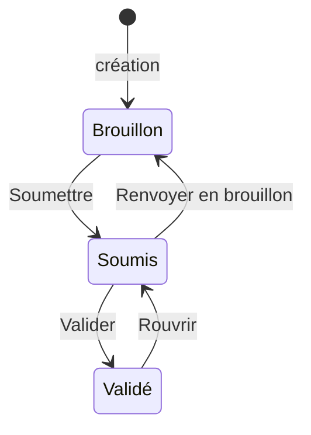
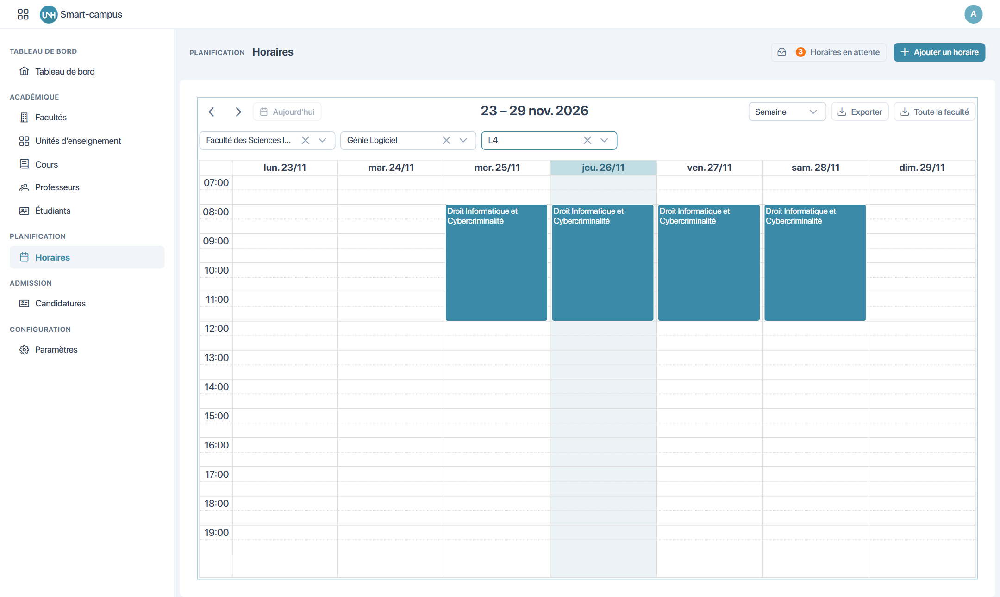
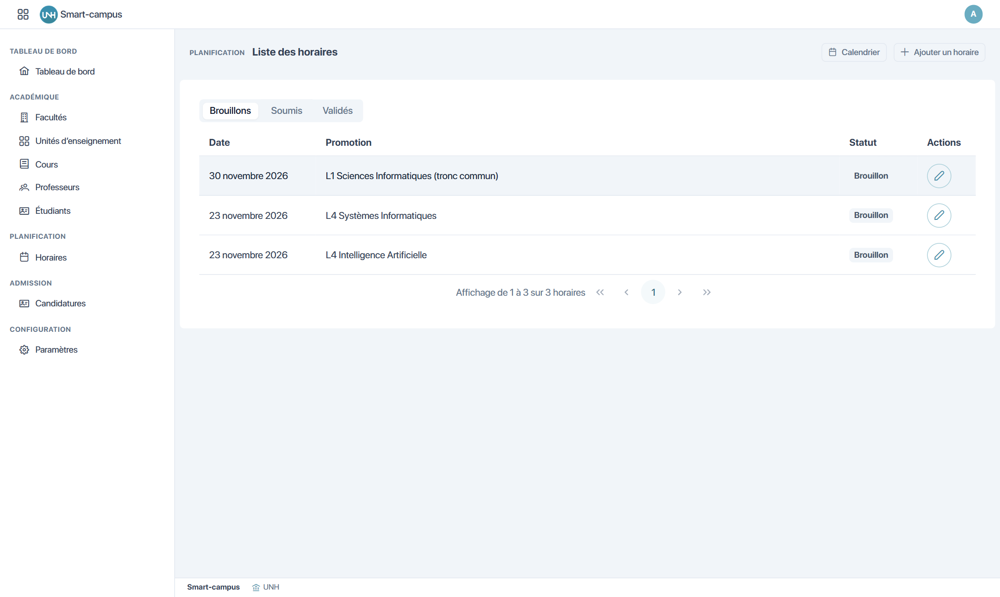
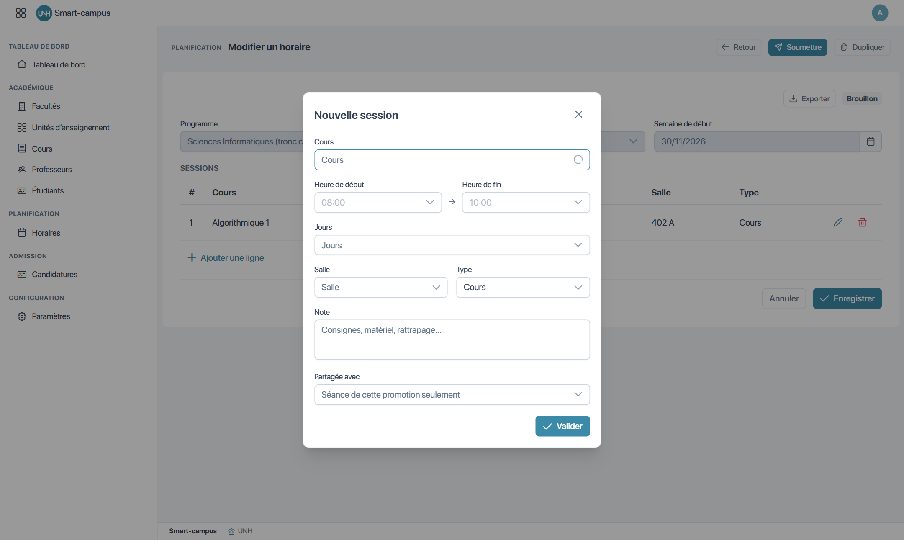

# Emplois du temps

Cette page explique comment construire l'horaire hebdomadaire d'une promotion, le faire valider, le publier et l'exporter.

**Profils concernés :**

- Administrateur, Secrétaire académique : **Planification › Horaires**.
- Professeur, Étudiant : **Planification › Mon horaire**.

## Notions

- Un **horaire** couvre **une promotion** (un programme à un niveau) pendant **une semaine**, du lundi au dimanche.
- Un horaire contient des **sessions** : un cours, un ou plusieurs jours, une heure de début et de fin, une salle et un type.
- Les types de session sont **Cours**, **Travaux pratiques**, **Examen** et **Test**.
- L'enseignant d'une session est le professeur affecté au cours (voir [Professeurs](professeurs.md#affecter-des-cours)). Seuls les cours qui ont un enseignant peuvent être planifiés.
- Une **séance partagée** est suivie par plusieurs promotions de la même faculté. Elle est saisie dans l'horaire d'une promotion, qui l'**héberge**.

### Statuts d'un horaire

| Statut | Signification | Sessions modifiables | Visible des étudiants |
|---|---|:-:|:-:|
| **Brouillon** | En préparation. | Oui | Non |
| **Soumis** | Envoyé pour validation. | Oui | Non |
| **Validé** | Publié. | Non | Oui |

| Bouton | Effet |
|---|---|
| **Soumettre** | L'horaire est soumis pour validation. Ses sessions restent modifiables. |
| **Renvoyer en brouillon** | L'horaire soumis repasse en brouillon. |
| **Valider** | L'horaire est publié aux étudiants. Ses sessions ne sont plus modifiables. |
| **Rouvrir** | L'horaire n'est plus visible des étudiants et repasse en **Soumis** : ses sessions redeviennent modifiables. |

## Consulter le calendrier

Menu **Planification › Horaires**.

1. Choisissez la **Faculté** (si votre profil couvre plusieurs facultés), le **Programme** et le **Niveau**.
2. Choisissez la vue : **Jour**, **Semaine**, **Mois** ou **Liste**.
3. Changez de période avec les flèches **Période précédente** et **Période suivante**. **Aujourd'hui** revient à la date du jour.
4. Cliquez sur une séance pour voir son détail : **Date**, **Type**, **Promotion**, **Enseignant**, **Salle** et **Note**.

Le calendrier n'affiche que les horaires **validés**. Les brouillons et les horaires soumis se trouvent dans **Horaires en attente**.

Sur un téléphone, les listes de choix se replient derrière le bouton **Filtres**.

## Les horaires en attente

Dans **Horaires**, cliquez sur **Horaires en attente**.

1. Choisissez l'onglet **Brouillons**, **Soumis** ou **Validés**.
2. La liste affiche la **Date** (la semaine), la **Promotion** et le **Statut** de chaque horaire.
3. Cliquez sur un horaire pour l'ouvrir.

**Calendrier** revient au calendrier. **Ajouter un horaire** crée un nouvel horaire.

## Créer un horaire

1. Dans **Horaires** ou **Horaires en attente**, cliquez sur **Ajouter un horaire**. L'écran **Nouvel horaire** s'ouvre.
2. Choisissez le **Programme**, puis le **Niveau**, puis la **Semaine de début** (un lundi).

**Résultat attendu :** l'horaire est créé automatiquement, au statut **Brouillon**. Si la promotion a déjà un horaire pour cette semaine, le message « Cette promotion a déjà un horaire pour cette semaine. » s'affiche : cliquez sur **Ouvrir l'horaire existant**.

### Ajouter des sessions

1. Dans la partie **Sessions**, cliquez sur **Ajouter une ligne**. La fenêtre **Nouvelle session** s'ouvre.
2. Choisissez le **Cours**. L'enseignant du cours est repris automatiquement.
3. Choisissez ou saisissez l'**Heure de début** et l'**Heure de fin**, par exemple « 08:30 » ou « 8h30 ».
4. Dans **Jours**, choisissez un ou plusieurs jours de la semaine.
5. Choisissez la **Salle** et le **Type**.
6. Ajoutez une **Note** si besoin : consignes, matériel, rattrapage…
7. Pour une séance partagée, choisissez dans **Partagée avec** les autres promotions qui y assistent.
8. Cliquez sur **Valider**. La session s'ajoute au tableau, mais elle n'est pas encore enregistrée.
9. Répétez pour chaque session, puis cliquez sur **Enregistrer**.

**Résultat attendu :** les sessions sont enregistrées. Un bouton de chaque ligne permet de modifier ou de supprimer la session ; cliquez ensuite à nouveau sur **Enregistrer**.

Si vous quittez la page sans enregistrer, une confirmation vous prévient : « Les sessions ne sont pas enregistrées. Quitter la page ? ». Si l'horaire vient d'être créé et ne contient aucune session, il est supprimé.

### Les séances partagées

- Dans l'horaire qui héberge la séance, la colonne de la ligne indique « Partagée avec » et les promotions invitées.
- Dans l'horaire d'une promotion invitée, la séance apparaît dans **Sessions partagées par d'autres promotions**, avec l'horaire qui l'héberge (**Hébergée par**). Elle se modifie seulement dans l'horaire qui l'héberge.
- Si une promotion invitée n'a pas encore d'horaire pour la semaine, il est créé en brouillon automatiquement. Un message l'indique.

## Faire valider et publier

1. Ouvrez l'horaire, depuis **Horaires en attente**.
2. Cliquez sur **Soumettre**, puis confirmez. L'horaire passe en **Soumis**.
3. La personne chargée de la validation ouvre l'horaire soumis et clique sur **Valider**, puis confirme.

**Résultat attendu :** le message « Horaire validé et publié aux étudiants. » s'affiche. L'horaire apparaît dans le calendrier et dans **Mon horaire** des étudiants et des professeurs concernés.

Pour corriger un horaire validé, cliquez sur **Rouvrir** : il repasse en **Soumis** et n'est plus visible des étudiants. Après correction, validez-le à nouveau.

## Dupliquer une semaine

Pour reprendre les mêmes séances une autre semaine :

1. Ouvrez un horaire qui contient des sessions enregistrées.
2. Cliquez sur **Dupliquer**.
3. Choisissez la **Semaine cible (lundi)**.
4. Cliquez sur **Dupliquer**.

**Résultat attendu :** le message « Semaine dupliquée : le nouvel horaire est en brouillon. » s'affiche. Toutes les séances sont copiées aux mêmes jours de la semaine choisie.

## Imprimer et exporter

Le bouton **Exporter** est présent dans le calendrier, dans un horaire ouvert et dans **Mon horaire**. Il propose :

- **Imprimer** ;
- **Télécharger le PDF** ;
- **Télécharger le fichier Excel**.

Le document reprend la grille de la semaine : jours, heures, cours, enseignants et salles.

Dans le calendrier, **Exporter** porte sur la promotion choisie. Il faut qu'elle ait un horaire validé sur la période affichée. Quand une faculté est choisie, le bouton **Toute la faculté** propose les mêmes choix pour tous les horaires validés de la faculté sur la période.

Dans un horaire ouvert, enregistrez d'abord les sessions modifiées pour les exporter.

## Consulter son horaire

**Profils concernés :** Étudiant, Professeur.

Le menu **Planification › Mon horaire** affiche :

- pour un **étudiant**, l'horaire validé de sa promotion ;
- pour un **professeur**, ses propres séances, toutes promotions confondues.

Les vues, la navigation et l'export fonctionnent comme dans le calendrier.

## Les salles

Les salles proposées dans les sessions se gèrent dans **Paramètres › Planification › Salles** (voir [Configuration](configuration.md#salles)).

## Erreurs fréquentes

| Message | Cause | Que faire |
|---|---|---|
| « Conflit avec un horaire ou un créneau existant. » | La salle ou l'enseignant est déjà pris sur ce créneau. | Choisissez une autre salle ou un autre créneau. |
| « Choisissez un autre créneau : l'enseignant n'est pas disponible. » | L'enseignant a déjà une séance à ce moment. | Changez de créneau. |
| « Chevauche la ligne … sur un même jour. » | Deux sessions de l'horaire se chevauchent. | Modifiez les heures ou les jours de l'une d'elles. |
| « Corrigez les sessions signalées avant d'enregistrer. » | Une ou plusieurs lignes sont marquées **À corriger**. | Ouvrez chaque ligne signalée et complétez-la. |
| « Enregistrez au moins une session avant de soumettre l'horaire. » | L'horaire est vide. | Ajoutez et enregistrez des sessions. |
| « Aucun cours avec un enseignant pour ce niveau » | Aucun cours de la promotion n'a de professeur affecté. | Affectez un professeur aux cours (voir [Professeurs](professeurs.md#affecter-des-cours)). |
| « Aucune année académique en cours : l'horaire ne peut pas être créé. » | Aucune année n'est active. | Activez une année dans **Paramètres › Académique › Années académiques**. |
| « Votre compte n'est rattaché à aucune faculté : demandez à un administrateur de le compléter. » | Le compte n'a pas de faculté. | Un administrateur renseigne la **Faculté** du compte dans **Paramètres › Identité › Utilisateurs**. |
| « Votre compte n'a pas d'horaire personnel : il est réservé aux étudiants et aux professeurs. » | Le compte n'est ni étudiant ni professeur. | Utilisez **Planification › Horaires**. |
