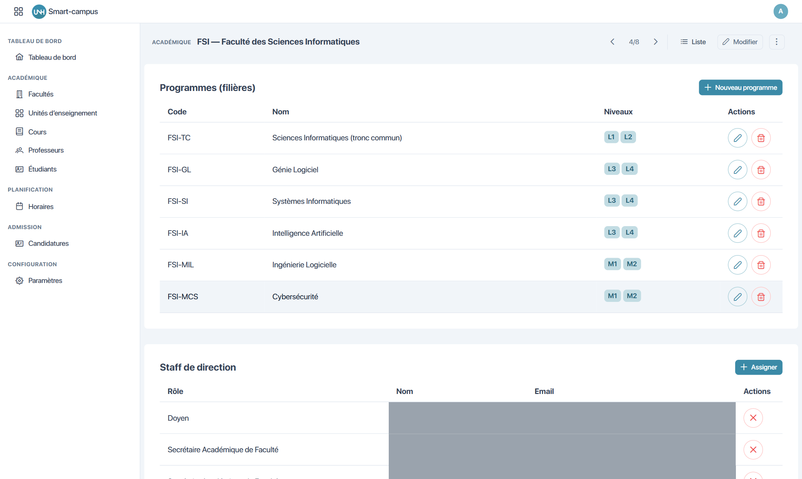
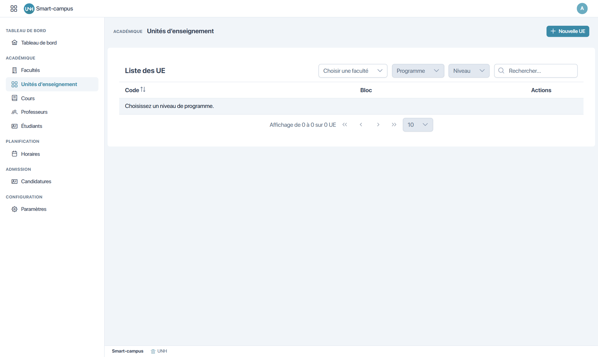

# Gestion académique

Cette page explique comment organiser l'offre de formation : facultés, programmes, unités d'enseignement (UE) et cours.

**Profils concernés :** Administrateur. Le Secrétaire académique, le Professeur et l'Étudiant consultent leur faculté par **Ma faculté**.

Les professeurs et leurs affectations sont traités dans [Professeurs](professeurs.md). Les années académiques, semestres, niveaux et grades se règlent dans [Configuration](configuration.md).

## Comment l'offre est organisée

| Élément | Définition | Où le gérer |
|---|---|---|
| **Faculté** | Une faculté de l'université, avec un code et un nom. | **Académique › Facultés** |
| **Programme** (filière) | Une filière d'une faculté, avec ses niveaux. | Fiche de la faculté |
| **Niveau** | Une année d'études, par exemple « L1 ». La liste des niveaux est commune à toute l'université. | **Paramètres › Académique › Niveaux** |
| **Promotion** | Un programme à un niveau donné, par exemple une filière en L1. | Découle des niveaux du programme |
| **Unité d'enseignement (UE)** | Un regroupement de cours, classé dans un **Bloc** : **Fondamental**, **Développement** ou **Transversal**. Une UE est inscrite dans une ou plusieurs promotions. | **Académique › Unités d'enseignement** |
| **Cours** | Un enseignement avec un code, un nom et des crédits. Un cours est rattaché à une UE. | **Académique › Cours** |

Ordre de saisie conseillé : faculté, puis programmes, puis UE, puis cours, puis affectation des professeurs.

## Les facultés

### Créer une faculté

1. Ouvrez **Académique › Facultés**.
2. Cliquez sur **Nouvelle faculté**.
3. Saisissez le **Code** (par exemple « FST ») et le **Nom**.
4. Cliquez sur **Enregistrer**.

**Résultat attendu :** le message « Faculté … créée. » s'affiche, et la faculté apparaît dans la liste.

### La fiche d'une faculté

Cliquez sur une faculté pour ouvrir sa fiche. Elle présente :

- **Programmes (filières)** : code, nom et niveaux de chaque programme ;
- **Staff de direction** : le **Rôle**, le **Nom** et l'**Email** des personnes qui ont un rôle de direction.

En haut de la fiche, **Modifier** change le code ou le nom de la faculté. **Supprimer**, dans le menu **Autres actions** (⋮), la supprime après confirmation.

### Ajouter un programme

1. Dans la fiche de la faculté, cliquez sur **Nouveau programme**.
2. Saisissez le **Code** (par exemple « FST-GL ») et le **Nom**.
3. Dans **Niveaux**, choisissez les niveaux du programme.
4. Cliquez sur **Enregistrer**.

**Résultat attendu :** le message « Programme créé. » s'affiche. Chaque niveau choisi forme une promotion.

Les boutons de chaque ligne permettent de modifier un programme ou de le supprimer.

### Désigner la direction

Les rôles de direction sont **Doyen**, **Vice-doyen** et **SAF** (secrétaire académique de faculté).

1. Dans la fiche de la faculté, partie **Staff de direction**, cliquez sur **Assigner**.
2. Dans **Utilisateur**, choisissez la personne. Elle doit déjà avoir un compte.
3. Dans **Rôle**, choisissez **Doyen**, **Vice-doyen** ou **SAF**.
4. Cliquez sur **Assigner**.

**Résultat attendu :** le message « Rôle de direction assigné. » s'affiche. Pour le rôle **SAF**, le compte reçoit aussi le profil **Secrétaire académique**, rattaché à cette faculté.

Pour retirer un rôle, cliquez sur le bouton **Retirer le rôle** de la ligne, puis confirmez. Le retrait du rôle **SAF** retire aussi le profil **Secrétaire académique**.

Si le message indique que le profil Secrétaire académique n'a pas pu être mis à jour, faites-le à la main dans **Paramètres › Identité › Utilisateurs** (voir [Utilisateurs, profils et droits](utilisateurs-droits.md)).

### Ma faculté

**Profils concernés :** Secrétaire académique, Professeur, Étudiant.

Le menu **Académique › Ma faculté** ouvre la fiche de la faculté de votre compte : programmes et staff de direction.

## Les unités d'enseignement

### Créer une UE

1. Ouvrez **Académique › Unités d'enseignement**.
2. Cliquez sur **Nouvelle UE**.
3. Choisissez la **Faculté**, le **Programme** et le **Niveau** : l'UE sera inscrite dans cette promotion.
4. Saisissez le **Code** (par exemple « UE-INFO-01 ») et choisissez le **Bloc**.
5. Cliquez sur **Enregistrer**.

**Résultat attendu :** l'UE apparaît dans la **Liste des UE**. Les listes **Faculté**, **Programme** et **Niveau**, au-dessus de la liste, filtrent les UE affichées.

### La fiche d'une UE

Cliquez sur une UE pour ouvrir sa fiche. Elle affiche le **Total crédits de l'UE**, les **Promotions** où l'UE est inscrite et les **Cours de l'UE**.

| Action | Procédure | Condition |
|---|---|---|
| **Inscrire dans une promotion** | Choisissez la **Promotion de la faculté** et le **Bloc dans cette promotion**, puis cliquez sur **Inscrire**. L'UE figurera au curriculum de cette promotion avec ses cours. | |
| **Retirer de la promotion** | Bouton de la ligne de la promotion, puis confirmation. | Impossible tant qu'un de ses cours a des séances à venir dans cette promotion. |
| **Rattacher un cours** | Choisissez le cours dans **Cours à rattacher**. Laissez **Crédits dans l'UE** vide pour reprendre les crédits du cours. Cliquez sur **Rattacher**. | Le cours doit appartenir à la faculté. |
| **Détacher le cours** | Bouton de la ligne du cours, puis confirmation. Le cours reste dans la faculté. | Impossible tant qu'il a des séances à venir dans une promotion de l'UE. |
| **Déplacer le cours** | Choisissez l'**UE de destination**, puis cliquez sur **Déplacer**. Le cours est rattaché à l'autre UE avec ses crédits, puis retiré de celle-ci. | Il faut une autre UE dans les promotions de celle-ci. |
| **Supprimer** l'UE | Bouton en haut de la fiche, puis confirmation. | Impossible tant qu'un de ses cours a des séances à venir. |

## Les cours

### Créer un cours

1. Ouvrez **Académique › Cours**.
2. Cliquez sur **Nouveau cours**.
3. Choisissez la **Faculté**, le **Programme**, le **Niveau**, puis l'**Unité d'enseignement**.
4. Saisissez le **Code** (par exemple « INF-101 »), le **Nom**, la **Description** et les **Crédits**.
5. Cliquez sur **Enregistrer**.

**Résultat attendu :** le message « Cours … créé. » s'affiche.

La liste affiche **Code**, **Nom**, **Crédits** et **Description**. Choisissez une faculté, un programme et un niveau pour voir les cours d'une promotion.

### La fiche d'un cours

Cliquez sur un cours pour ouvrir sa fiche. Elle présente :

- **Informations** : code, nom, crédits, **UE de la promotion** et description ;
- **Collaborateurs** : les professeurs assignés au cours, avec leur rôle.

Pour modifier le cours, cliquez sur **Modifier**, changez le **Code**, le **Nom**, la **Description** ou les **Crédits par défaut**, puis cliquez sur **Enregistrer**.

L'assignation des professeurs depuis cette fiche est décrite dans [Professeurs](professeurs.md#assigner-un-professeur-a-un-cours).

## Erreurs fréquentes

| Message | Cause | Que faire |
|---|---|---|
| « Le code est obligatoire. » ou « Le nom est obligatoire. » | Un champ obligatoire est vide. | Complétez-le. |
| « Impossible de supprimer cette faculté. » | Le serveur a refusé la suppression. | Le message détaillé du serveur, s'il est affiché, indique la raison. Sinon, contactez un administrateur. |
| « Impossible de retirer l'UE de cette promotion. » ou « Impossible de détacher ce cours. » | Des séances à venir utilisent ces cours. | Retirez d'abord les séances concernées des horaires. |
| « Choisissez un niveau de programme. » | Aucune promotion n'est choisie dans la liste des cours. | Choisissez une faculté, un programme et un niveau. |
| « Permission identity:user:read:all requise pour assigner un staff. » | Votre profil ne peut pas lister les utilisateurs. | Demandez à un administrateur. |
