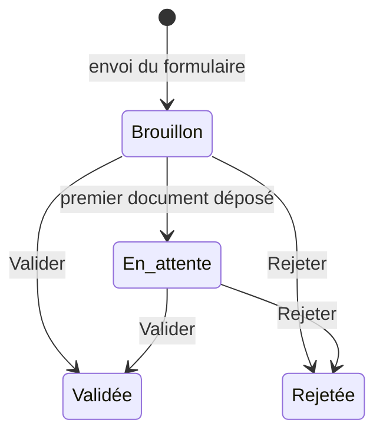
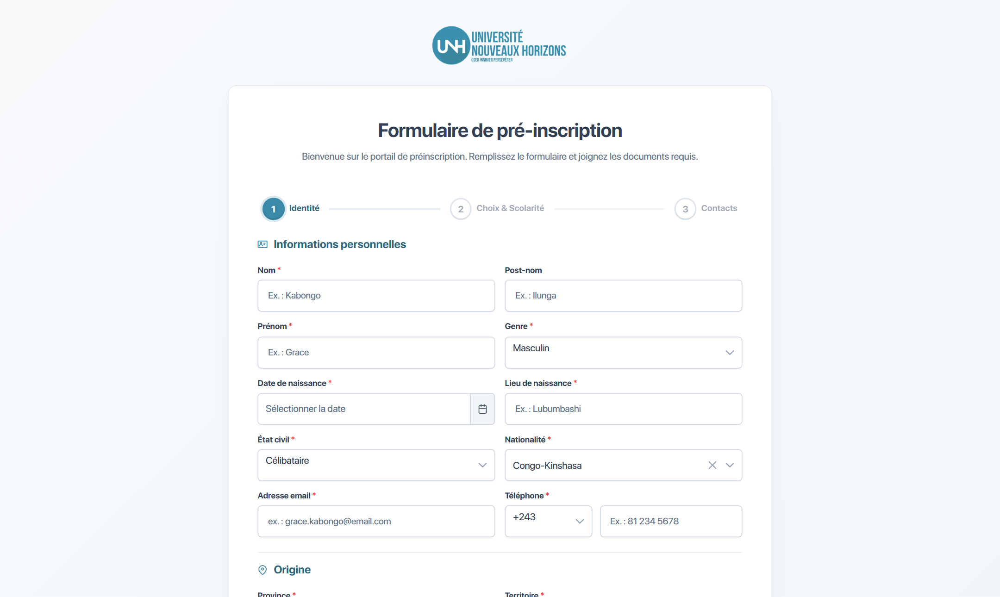

# Parcours candidat et étudiant

Cette page suit une personne de la pré-inscription en ligne jusqu'à son espace étudiant.

**Profils concernés :** visiteur sans compte (pré-inscription), Candidat, Étudiant.

Le traitement des candidatures par l'université est décrit dans [Candidatures et étudiants](candidatures-etudiants.md).

## Vue d'ensemble

1. Le visiteur remplit le **Formulaire de pré-inscription**, sans compte.
2. Il reçoit par e-mail ses identifiants de connexion. Son compte a le profil **Candidat**.
3. Il se connecte, ouvre **Mon dossier** et dépose ses documents.
4. L'université valide ou rejette la candidature. Le candidat est prévenu par e-mail.
5. Si la candidature est validée, le compte reçoit le profil **Étudiant**, et une fiche étudiant avec un matricule est créée.

### Statuts d'une candidature

| Statut | Signification | Le candidat peut modifier son dossier |
|---|---|:-:|
| **Brouillon** | Formulaire envoyé, aucun document déposé. | Oui |
| **En attente** | Au moins un document a été déposé. La candidature attend la décision de l'université. | Oui |
| **Validée** | La candidature est acceptée : la personne devient étudiante. | Non |
| **Rejetée** | La candidature est refusée, avec un motif. | Non |
| **Annulée** | La candidature est annulée. | Non |

Sur ce schéma, « En_attente » correspond au statut **En attente**.

## Remplir le formulaire de pré-inscription

**Profil concerné :** visiteur sans compte.

Le formulaire est à l'adresse `/apply` de l'application. Il comporte trois étapes : **Identité**, **Choix & Scolarité** et **Contacts**.

1. Ouvrez le **Formulaire de pré-inscription**.
2. Étape **Identité** : renseignez les **Informations personnelles** (**Nom**, **Post-nom**, **Prénom**, **Genre**, **Date de naissance**, **Lieu de naissance**, **État civil**, **Nationalité**, **Adresse email**, téléphone avec l'indicatif du pays) et l'**Origine** (**Province**, **Territoire**, **Secteur**, **Village**).
3. Cliquez sur **Étape suivante**.
4. Étape **Choix & Scolarité** : choisissez la **Faculté**, puis la **Filière**, puis la **Promotion**. Renseignez le **Parcours scolaire** : nom de l'école secondaire, option d'études, **Pourcentage** (entre 50 et 100), année d'obtention du diplôme, **Pays d'étude** et **Ville d'étude**.
5. Cliquez sur **Étape suivante**.
6. Étape **Contacts** : renseignez le tuteur (nom complet, téléphone, e-mail, profession) et le contact d'urgence (nom complet, téléphone, e-mail, lien de parenté).
7. Cliquez sur **Envoyer**.

**Résultat attendu :** l'écran **Candidature enregistrée** affiche un récapitulatif et le message « Consultez votre boîte mail : vos identifiants de connexion vous y ont été envoyés. » La candidature est au statut **Brouillon**.

**Retour** revient à l'étape précédente. Une étape incomplète bloque le passage à la suivante : les champs à corriger sont signalés en rouge.

## Compléter son dossier

**Profil concerné :** Candidat.

Le menu **Admission › Mon dossier** affiche le dossier : identité, coordonnées, choix académique, parcours scolaire, tuteur et contact d'urgence, puis les **Documents**.

### Déposer les documents

Le dossier attend quatre pièces : **Pièce d'identité**, **Diplôme**, **Bulletins / Relevés de notes** et **Preuve de paiement**. Le compteur indique le nombre de pièces déposées, par exemple « 2/4 pièces ».

1. Ouvrez **Mon dossier**.
2. Pour chaque pièce, cliquez sur **Choisir** et sélectionnez le fichier. Pour une pièce déjà déposée, le bouton s'appelle **Remplacer**.
3. Cliquez sur **Téléverser les documents choisis**.

**Résultat attendu :** le message « Les documents ont été téléversés avec succès. » s'affiche. Au premier dépôt, la candidature passe au statut **En attente**.

### Modifier ses informations

1. Dans **Mon dossier**, cliquez sur **Modifier**.
2. Corrigez les champs.
3. Cliquez sur **Enregistrer**.

**Résultat attendu :** le message « Vos informations ont été enregistrées. » s'affiche.

Les boutons **Modifier**, **Choisir** et **Remplacer** ne sont disponibles qu'aux statuts **Brouillon** et **En attente**.

## Après la décision

- **Candidature validée :** le candidat reçoit un e-mail. **Mon dossier** affiche « Bienvenue dans votre parcours étudiant ». Le compte reçoit le profil **Étudiant**.
- **Candidature rejetée :** le candidat reçoit un e-mail avec le motif du rejet.

## L'espace étudiant

**Profil concerné :** Étudiant.

| Menu | Contenu |
|---|---|
| **Planification › Mon horaire** | L'horaire de votre promotion. Seuls les horaires validés sont visibles. Voir [Emplois du temps](emplois-du-temps.md#consulter-son-horaire). |
| **Académique › Ma faculté** | Votre faculté, ses programmes et sa direction, en consultation. |
| **Académique › Professeurs** | La liste des professeurs. |

## Erreurs fréquentes

| Message | Cause | Que faire |
|---|---|---|
| **Préinscriptions indisponibles** | La période d'inscription n'est pas ouverte. | Réessayez plus tard, ou contactez le service des admissions. |
| « Une candidature existe déjà avec cet e-mail. Utilisez une autre adresse ou contactez le service des admissions. » | Une candidature a déjà été envoyée avec cette adresse. | Connectez-vous avec les identifiants reçus, ou contactez le service des admissions. |
| « Aucun programme n'est rattaché à cette faculté. » | La faculté choisie n'a pas encore de filière. | Choisissez une autre faculté, ou contactez le service des admissions. |
| « Le numéro ou l'indicatif du pays est invalide. » | Le numéro ne correspond pas au pays choisi. | Vérifiez l'indicatif et le numéro. |
| « Sélectionnez au moins un document à téléverser. » | Aucun fichier n'a été choisi. | Cliquez sur **Choisir** pour au moins une pièce. |
| « Certains documents n'ont pas pu être envoyés. Réessayez. » | Une partie des fichiers n'a pas été reçue. | Choisissez à nouveau les pièces manquantes, puis téléversez-les. |
| **Aucune candidature trouvée** | Le compte n'a pas de dossier d'admission. | Contactez le service des admissions. |
