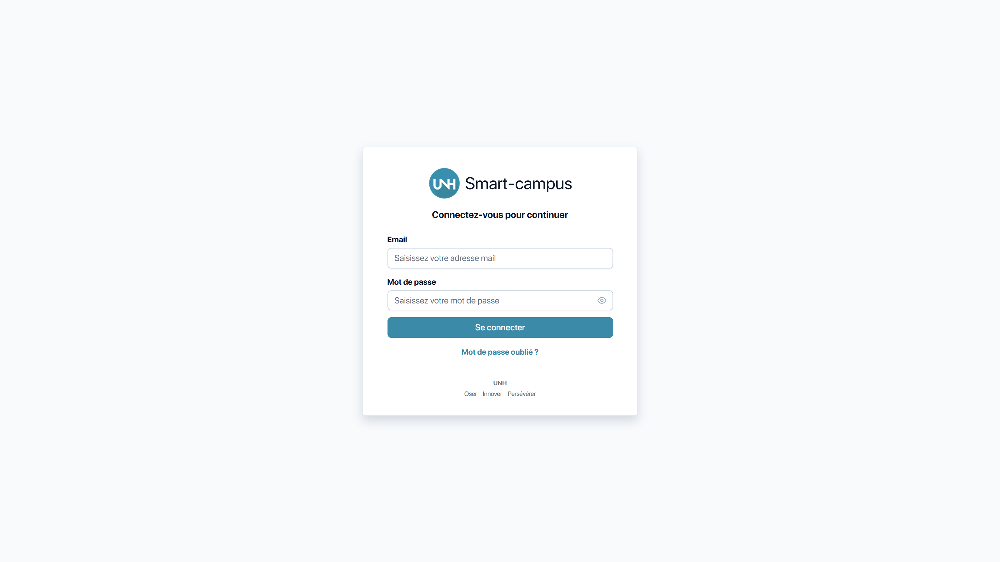
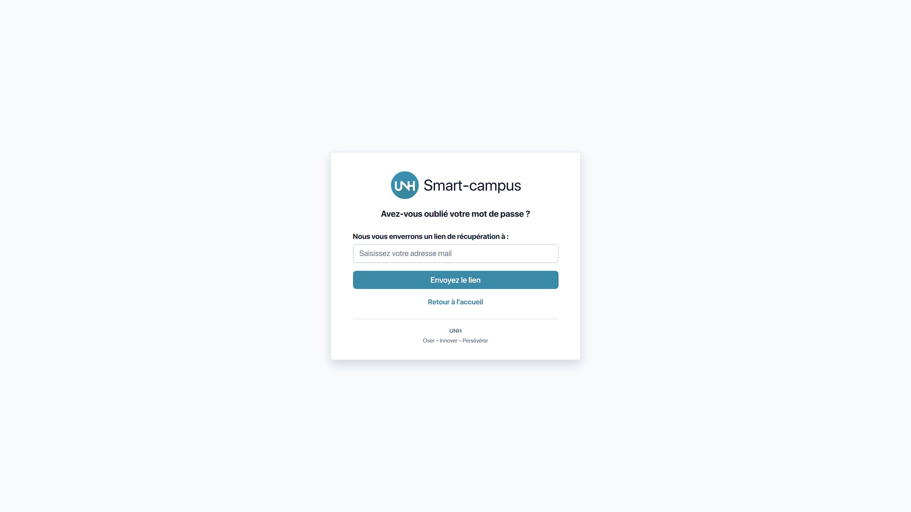
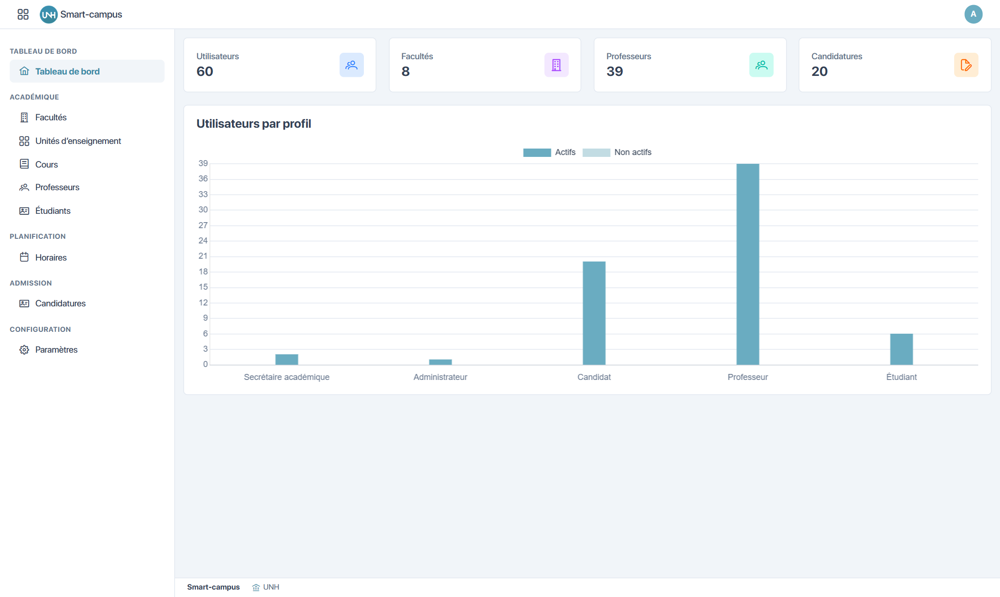

# Prise en main

Cette page explique comment se connecter, se repérer dans l'application, gérer son compte et utiliser les listes. Elle concerne tous les utilisateurs.

**Profils concernés :** Administrateur, Secrétaire académique, Professeur, Étudiant, Candidat.

## Profils et accès

Ce que vous voyez dans le menu dépend de votre **profil métier**. Un compte peut avoir plusieurs profils.

| Écran | Administrateur | Secrétaire académique | Professeur | Étudiant | Candidat |
|---|:-:|:-:|:-:|:-:|:-:|
| Tableau de bord | ✓ | ✓ | ✓ | ✓ | ✓ |
| Profil, Préférences | ✓ | ✓ | ✓ | ✓ | ✓ |
| Académique › Facultés, Unités d'enseignement, Cours | ✓ | | | | |
| Académique › Ma faculté | | ✓ | ✓ | ✓ | |
| Académique › Mes cours | | | ✓ | | |
| Académique › Professeurs | ✓ | ✓ | ✓ | ✓ | |
| Académique › Étudiants | ✓ | ✓ | | | |
| Planification › Horaires | ✓ | ✓ | | | |
| Planification › Mon horaire | | | ✓ | ✓ | |
| Admission › Candidatures | ✓ | ✓ | | | |
| Admission › Mon dossier | | | | | ✓ |
| Configuration › Paramètres | ✓ | ✓ | | | |

Les droits de chaque profil sont définis sur le serveur. Ce tableau reflète la configuration actuelle et peut évoluer.

Dans un écran, un bouton de création, de modification ou de suppression n'apparaît que si votre profil a ce droit. Si un bouton décrit dans ce guide est absent de votre écran, votre profil ne le permet pas.

## Se connecter

1. Ouvrez l'adresse de l'application dans votre navigateur.
2. Dans **Email**, saisissez votre adresse.
3. Dans **Mot de passe**, saisissez votre mot de passe.
4. Cliquez sur **Se connecter**.

**Résultat attendu :** le tableau de bord s'affiche.

Les candidats reçoivent leurs identifiants par e-mail après l'envoi du formulaire de pré-inscription (voir [Parcours candidat et étudiant](parcours-candidat-etudiant.md)). Les autres comptes sont créés par un administrateur (voir [Utilisateurs, profils et droits](utilisateurs-droits.md)).

## Mot de passe oublié

1. Sur la page de connexion, cliquez sur **Mot de passe oublié ?**.
2. Saisissez votre adresse e-mail.
3. Cliquez sur **Envoyez le lien**.

**Résultat attendu :** le message « Si cette adresse email est associée à un compte, un lien de récupération vous sera envoyé. » s'affiche. Ce message est le même que l'adresse existe ou non.

Pour choisir un nouveau mot de passe :

1. Ouvrez le lien reçu par e-mail. La page **Choisir un nouveau mot de passe** s'affiche.
2. Saisissez le **Nouveau mot de passe**. Il doit respecter toutes les règles affichées :
    - au moins une lettre minuscule ;
    - au moins une lettre majuscule ;
    - au moins un chiffre ;
    - au moins un caractère spécial parmi `@ $ ! % * ? &` ;
    - entre 8 et 12 caractères.
3. Saisissez-le à nouveau dans **Confirmation du mot de passe**.
4. Cliquez sur **Continuer**.

**Résultat attendu :** vous revenez à la page de connexion avec le message « Votre mot de passe a été réinitialisé avec succès. Veuillez vous connecter. »

## Se repérer dans l'application

L'écran se compose de trois zones :

- **la barre supérieure**, avec le nom de l'application et le bouton **Profil utilisateur** (en haut à droite) ;
- **le menu latéral**, organisé en sections : **Tableau de bord**, **Académique**, **Planification**, **Admission** et **Configuration** ;
- **la zone de travail**. En haut, une barre rappelle où vous êtes (par exemple « Académique » puis « Facultés ») et regroupe les boutons de l'écran, comme **Nouvelle faculté** ou **Modifier**. Quand les boutons sont nombreux, les moins utilisés sont rangés dans le menu **Autres actions** (⋮).

Une section du menu n'apparaît que si votre profil donne accès à au moins un de ses écrans.

### Le tableau de bord

Le tableau de bord affiche des indicateurs selon votre profil :

| Widget | Contenu | Profils |
|---|---|---|
| **Facultés** | Nombre de facultés | Administrateur |
| **Professeurs** | Nombre de professeurs | Administrateur, Secrétaire académique, Professeur, Étudiant |
| **Candidatures** | Nombre de candidatures | Administrateur, Secrétaire académique |
| **Utilisateurs** | Nombre d'utilisateurs | Administrateur, Secrétaire académique |
| **Utilisateurs par profil** | Répartition des comptes par profil, actifs et non actifs | Administrateur, Secrétaire académique |

## Gérer son compte

Cliquez sur le bouton **Profil utilisateur**, en haut à droite. Le menu propose **Profil**, **Préférences** et **Se déconnecter**.

### Modifier son profil

L'écran **Mon profil** contient deux parties : **Informations personnelles** et **Mot de passe**.

1. Dans le menu du compte, cliquez sur **Profil**.
2. Cliquez sur **Modifier**.
3. Modifiez le **Nom d'utilisateur** ou l'**Email**. Le nom d'utilisateur doit contenir 3 à 30 caractères, commencer par une lettre et ne pas contenir d'espace.
4. Pour changer de photo, cliquez sur **Changer la photo de profil** et choisissez une image PNG ou JPG.
5. Cliquez sur **Enregistrer**.

**Résultat attendu :** le message « Profil modifié avec succès. » s'affiche. Si le message vous demande de vous reconnecter, reconnectez-vous.

Vos **Profils métier** s'affichent sur cet écran, mais vous ne pouvez pas les modifier vous-même.

### Changer son mot de passe

1. Dans **Mon profil**, partie **Mot de passe**, saisissez le **Mot de passe actuel**.
2. Saisissez le **Nouveau mot de passe** : 8 à 16 caractères, avec une majuscule, une minuscule, un chiffre et un caractère spécial.
3. Saisissez-le à nouveau dans **Confirmation du mot de passe**.
4. Cliquez sur **Modifier le mot de passe**.

**Résultat attendu :** le message « Mot de passe modifié avec succès. » s'affiche.

### Choisir l'apparence

1. Dans le menu du compte, cliquez sur **Préférences**.
2. Dans **Thème de l'interface**, choisissez **Clair** ou **Sombre**.
3. Dans **Preset de l'interface**, choisissez un style : **Aura**, **Lara** ou **Nora**.
4. Cliquez sur **Enregistrer les modifications**.

**Résultat attendu :** l'apparence change. **Réinitialiser** rétablit la configuration par défaut.

Ces préférences sont enregistrées dans votre navigateur : sur un autre ordinateur, vous retrouvez l'apparence par défaut.

### Se déconnecter

Dans le menu du compte, cliquez sur **Se déconnecter**. Vous revenez à la page de connexion.

## Travailler avec les listes

Les listes **Candidatures**, **Étudiants**, **Professeurs**, **Cours** et **Salles** partagent les mêmes outils. Les autres listes proposent au moins un champ de recherche.

### Rechercher et filtrer

- **Rechercher…** : tapez un mot. La liste ne garde que les lignes qui le contiennent.
- **Listes déroulantes** à côté de la recherche, par exemple **Toutes les facultés** ou **Tous les statuts** : elles restreignent la liste.
- **Filtres** : un filtre précis sur une colonne.

Pour ajouter un filtre :

1. Cliquez sur **Filtres**.
2. Dans **Colonne**, choisissez la colonne.
3. Dans **Condition**, choisissez par exemple « contient », « est l'une des valeurs », « entre » ou « est vide ».
4. Indiquez la valeur, ou cochez les valeurs voulues.
5. Cliquez sur **Ajouter le filtre**.

**Résultat attendu :** le filtre s'affiche sous la barre de recherche, et le nombre de filtres actifs apparaît sur le bouton **Filtres**. Cliquez sur la croix d'un filtre pour le retirer, ou sur **Tout effacer** pour tous les retirer.

### Les boutons de la liste

Ces boutons sont des icônes situées au-dessus du tableau. Leur nom s'affiche au survol.

| Bouton | Effet |
|---|---|
| **Colonnes** | Choisir les colonnes affichées. **Colonnes par défaut** rétablit le choix initial. |
| **Imprimer** | Imprime la liste telle qu'elle est affichée : lignes filtrées et colonnes choisies. |
| **Exporter en Excel** | Télécharge la liste affichée dans un fichier Excel. |
| **Actualiser** | Recharge la liste depuis le serveur. |
| **Importer** | Crée des éléments à partir d'un fichier Excel. Présent seulement sur certaines listes, par exemple les **Salles**. |

### Importer depuis Excel

1. Cliquez sur **Importer**.
2. Cliquez sur **Télécharger le modèle**.
3. Remplissez le modèle : une ligne par élément. Les colonnes marquées `*` sont obligatoires.
4. Choisissez le fichier rempli, au format `.xlsx`.
5. Vérifiez le contrôle affiché : nombre de lignes prêtes et lignes à corriger, avec la raison de chaque erreur.
6. Cliquez sur **Importer N ligne(s)**, où N est le nombre de lignes prêtes.

**Résultat attendu :** le message « … ligne(s) importée(s). » s'affiche, et la liste est actualisée. Les lignes à corriger ne sont pas importées. Les lignes refusées par le serveur sont listées avec leur motif.

## Messages fréquents

| Message | Signification | Que faire |
|---|---|---|
| « Email ou mot de passe incorrect. Veuillez réessayer. » | L'adresse ou le mot de passe est faux. | Vérifiez la saisie, ou utilisez **Mot de passe oublié ?**. |
| « Votre compte ne dispose pas des autorisations nécessaires pour accéder à la plateforme. » | Le compte n'a aucun droit. | Contactez un administrateur. |
| « Impossible de joindre le serveur. » | Le serveur ne répond pas. | Vérifiez votre connexion, puis réessayez. |
| « Trop de tentatives ont été effectuées. Veuillez patienter avant de réessayer. » | Trop de demandes de lien en peu de temps. | Attendez quelques minutes. |
| « Le lien de réinitialisation est invalide ou incomplet. » | Le lien reçu est incomplet ou n'est plus valable. | Refaites une demande avec **Mot de passe oublié ?**. |
| **Accès refusé** | Votre profil ne donne pas accès à cette page. | Si vous pensez qu'il s'agit d'une erreur, contactez un administrateur. |
| **Page introuvable** | L'adresse n'existe pas. | Vérifiez l'adresse, ou cliquez sur **Retour à l'accueil**. |
| « Session expirée. Reconnecte-toi pour continuer. » | Votre session a expiré. | Reconnectez-vous. |
