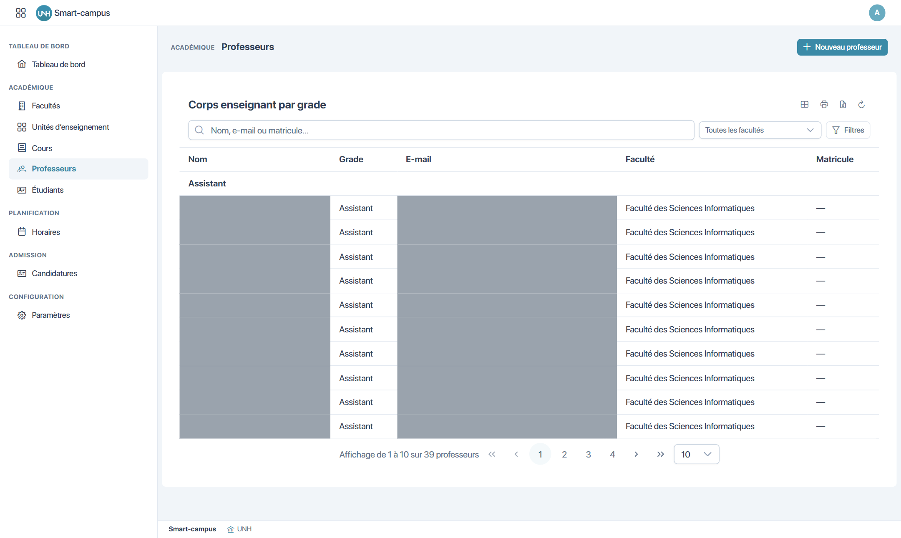

# Professeurs

Cette page explique comment enregistrer les professeurs et leur affecter des cours.

**Profils concernés :**

- Administrateur : création, modification, affectation.
- Secrétaire académique, Professeur, Étudiant : consultation de la liste et des fiches.
- Professeur : **Mes cours**.

## La liste des professeurs

Menu **Académique › Professeurs**.

La liste **Corps enseignant par grade** regroupe les professeurs par grade. Elle affiche **Nom**, **Grade**, **E-mail**, **Faculté** et **Matricule**. La colonne **Téléphone** peut être ajoutée avec le bouton **Colonnes**.

Le champ de recherche accepte un nom, un e-mail ou un matricule. **Toutes les facultés** restreint la liste à une faculté. La recherche, les filtres, l'impression et l'export Excel sont décrits dans [Travailler avec les listes](prise-en-main.md#travailler-avec-les-listes).

## Enregistrer un professeur

**Profil concerné :** Administrateur.

1. Cliquez sur **Nouveau professeur**.
2. Renseignez les champs obligatoires, marqués `*` : **Nom**, **Prénom**, **Genre**, **Faculté**, **Grade** et **E-mail**.
3. Complétez si besoin : **Postnom**, **Matricule**, **État civil**, **Date de naissance**, **Lieu de naissance**, **Nationalité** et **Téléphone**.
4. Cliquez sur **Enregistrer**.

**Résultat attendu :** le professeur apparaît dans la liste. Un compte de connexion est créé avec le profil **Professeur**, rattaché à la faculté choisie, et le professeur reçoit ses identifiants par e-mail.

Les grades proposés se règlent dans **Paramètres › Académique › Grades professeurs** (voir [Configuration](configuration.md#grades-professeurs)).

## La fiche d'un professeur

Cliquez sur un professeur pour ouvrir sa fiche. Elle présente :

- **Informations personnelles** : état civil et coordonnées ;
- **Cours enseignés** : les cours affectés, avec le **Rôle** de l'enseignant.

En haut de la fiche :

- **Modifier** ouvre **Modifier le professeur**. Corrigez les champs, puis cliquez sur **Enregistrer**. Message attendu : « Professeur modifié. »
- **Supprimer** supprime le professeur après confirmation.

## Affecter des cours

Un professeur est affecté à un cours pour l'année académique active, avec l'un de ces rôles :

| Rôle | Signification |
|---|---|
| **Titulaire** | Responsable du cours. Un cours a au plus un titulaire par année. |
| **Assistant** | Intervient sur le cours avec le titulaire. |

L'affectation se fait depuis la fiche du professeur ou depuis celle du cours. Le résultat est le même.

### Depuis la fiche du professeur

1. Ouvrez la fiche du professeur.
2. Cliquez sur **Nouvelle affectation**.
3. Choisissez le **Cours** et le **Rôle**.
4. Cliquez sur **Affecter**.

**Résultat attendu :** le message « Cours affecté. » s'affiche, et le cours apparaît dans **Cours enseignés**.

### Assigner un professeur à un cours

1. Ouvrez la fiche du cours (**Académique › Cours**).
2. Dans **Collaborateurs**, cliquez sur **Assigner**.
3. Choisissez le **Professeur** et le **Rôle**. L'**Année académique** est l'année active.
4. Cliquez sur **Assigner**.

**Résultat attendu :** le message « Professeur assigné. » s'affiche, et le professeur apparaît dans **Collaborateurs**.

Pour retirer un professeur d'un cours, cliquez sur le bouton **Retirer l'assignation** de sa ligne, puis sur **Retirer**.

L'enseignant d'une séance d'horaire est le professeur affecté au cours. Sans affectation, le cours ne peut pas être planifié (voir [Emplois du temps](emplois-du-temps.md)).

## Mes cours

**Profil concerné :** Professeur.

Le menu **Académique › Mes cours** affiche **Cours qui me sont assignés** : **Code**, **Nom** et **Rôle** de chaque cours. Les séances se consultent dans **Planification › Mon horaire**.

## Erreurs fréquentes

| Message | Cause | Que faire |
|---|---|---|
| « Un professeur existe déjà avec cet e-mail. » | L'adresse est déjà utilisée par un professeur. | Vérifiez la liste : le professeur est peut-être déjà enregistré. |
| « Ce cours a déjà un titulaire pour cette année. » | Le cours a déjà un **Titulaire**. | Retirez d'abord l'ancien titulaire, ou choisissez le rôle **Assistant**. |
| « Ce professeur est déjà assigné à ce cours pour cette année. » ou « Ce cours est déjà affecté à ce professeur pour cette année. » | L'affectation existe déjà. | Aucune action. |
| « Aucune année académique active. » | Aucune année n'est active. | Activez une année dans **Paramètres › Académique › Années académiques**. |
| « Aucun cours ne vous est affecté pour le moment. » | Aucun cours n'est affecté à votre compte professeur. | Contactez votre secrétariat académique. |
