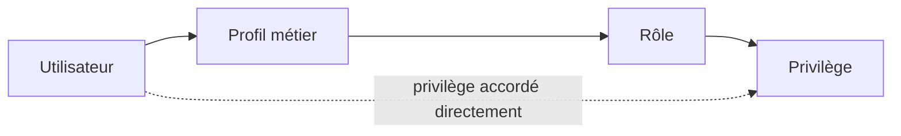
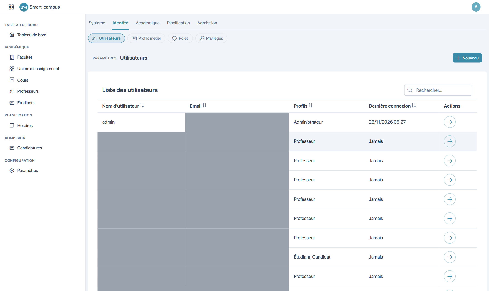
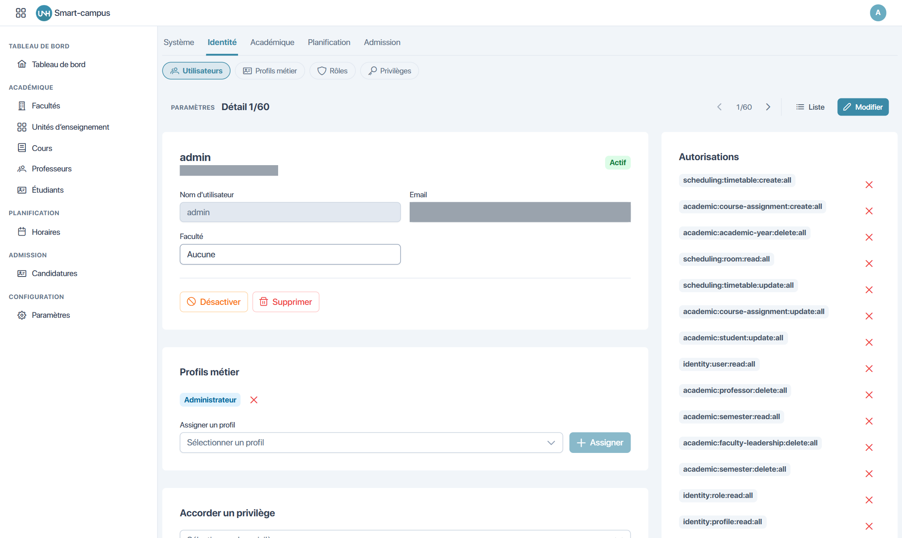
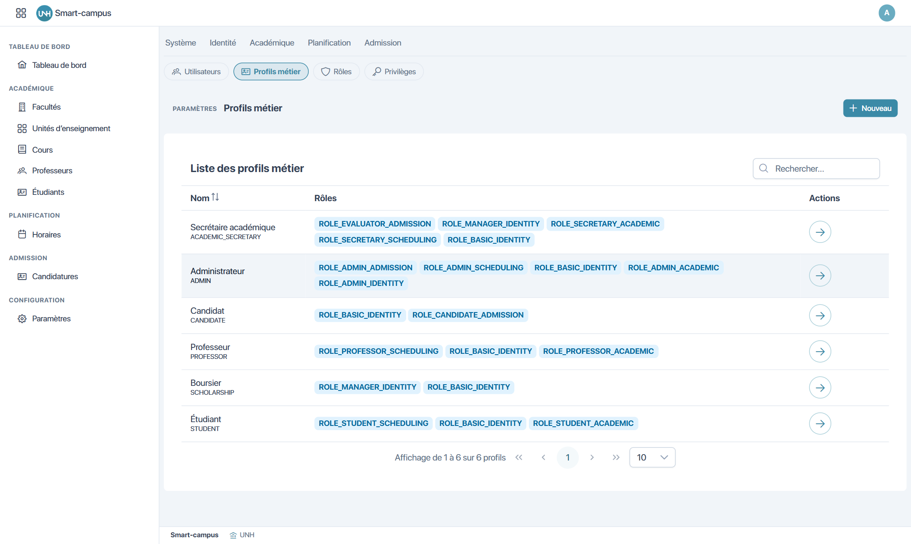
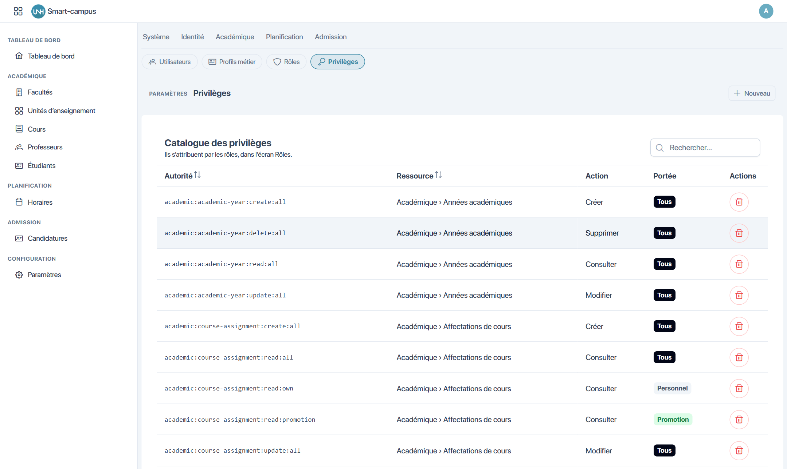

# Utilisateurs, profils et droits

Cette page explique comment créer les comptes et régler ce que chacun peut faire dans l'application.

**Profils concernés :** Administrateur. Le profil Secrétaire académique a aussi accès à ces écrans dans la configuration actuelle.

Menu **Configuration › Paramètres**, onglet **Identité**. Il contient quatre écrans : **Utilisateurs**, **Profils métier**, **Rôles** et **Privilèges**.

## Comment les droits sont organisés

Les droits s'emboîtent sur quatre niveaux :

| Élément | Définition | Exemple |
|---|---|---|
| **Utilisateur** | Un compte de connexion. | Le compte d'un professeur. |
| **Profil métier** | La fonction de la personne. Un compte peut en avoir plusieurs. | **Administrateur**, **Secrétaire académique**, **Professeur**, **Étudiant**, **Candidat**. |
| **Rôle** | Un ensemble de privilèges, attaché à un ou plusieurs profils. Son nom suit le format `ROLE_XXX`. | `ROLE_ADMIN` |
| **Privilège** | Un droit précis : une action sur un type d'élément, avec une **portée**. | « Cours — Consulter (Faculté) » |

La **portée** d'un privilège indique sur quoi il s'applique :

| Portée | S'applique à |
|---|---|
| **Personnel** | Ce qui concerne la personne elle-même : son dossier, son horaire. |
| **Promotion** | Sa promotion. |
| **Programme** | Son programme. |
| **Faculté** | Sa faculté. Le compte doit être rattaché à une faculté. |
| **Tous** | Toute l'université. |

Dans la plupart des cas, il suffit d'attribuer le bon **profil métier** à un compte. Les rôles et les privilèges se modifient rarement.

Certains comptes sont créés automatiquement : celui d'un candidat à l'envoi de sa pré-inscription, et celui d'un professeur à son enregistrement (voir [Professeurs](professeurs.md#enregistrer-un-professeur)).

## Les utilisateurs

Écran **Utilisateurs**.

La **Liste des utilisateurs** affiche : **Nom d'utilisateur**, **Email**, **Profils** et **Dernière connexion** (« Jamais » pour un compte qui ne s'est jamais connecté).

### Créer un utilisateur

1. Cliquez sur **Nouveau**. L'écran **Créer un nouvel utilisateur** s'ouvre.
2. Saisissez le **Nom d'utilisateur** : 3 à 30 caractères, sans espace.
3. Saisissez l'**Email**.
4. Dans **Profils métier**, choisissez au moins un profil.
5. Choisissez la **Faculté (facultatif)**. Elle est nécessaire pour les profils dont les droits portent sur une faculté, comme le Secrétaire académique.
6. Cliquez sur **Créer**.

**Résultat attendu :** le message « Utilisateur … créé avec succès. » s'affiche. La personne reçoit ses identifiants de connexion par e-mail.

### La fiche d'un utilisateur

Cliquez sur un utilisateur pour ouvrir sa fiche.

| Action | Procédure | Résultat attendu |
|---|---|---|
| **Modifier** le compte | Cliquez sur **Modifier**, changez le **Nom d'utilisateur**, l'**Email** ou la **Faculté**, puis cliquez sur **Enregistrer**. | « Utilisateur mis à jour avec succès. » |
| **Désactiver** | Cliquez sur **Désactiver**. La personne ne peut plus se connecter. | « Utilisateur désactivé. » |
| **Activer** | Cliquez sur **Activer** pour un compte désactivé. | « Utilisateur activé. » |
| **Assigner un profil** | Choisissez le profil dans **Assigner un profil**, puis cliquez sur **Assigner**. | « Profil assigné avec succès. » |
| Retirer un profil | Cliquez sur la croix du profil, dans **Profils métier**. | « Profil retiré avec succès. » |
| **Accorder un privilège** | Choisissez un ou plusieurs privilèges, puis cliquez sur **Accorder**. Ces privilèges s'ajoutent à ceux des profils. | « Privilège(s) accordé(s). » |
| Révoquer un privilège | Cliquez sur la croix du privilège, dans **Autorisations**, puis sur **Révoquer**. | « Privilège révoqué. » |
| **Supprimer** | Cliquez sur **Supprimer**, puis confirmez. | « Utilisateur supprimé avec succès. » |

La partie **Autorisations** liste tous les droits du compte. La partie **Informations** indique les dates de création, de modification et de dernière connexion.

**Précédent** et **Suivant** passent à l'utilisateur voisin dans la liste.

## Les profils métier

Écran **Profils métier**.

La **Liste des profils métier** affiche chaque profil et ses **Rôles**.

- **Créer un profil :** cliquez sur **Nouveau**, saisissez le **Nom du profil** (2 caractères au moins), puis cliquez sur **Créer**.
- **Ajouter des rôles à un profil :** ouvrez le profil, choisissez les rôles dans **Ajouter des rôles**, puis cliquez sur **Ajouter**. Message attendu : « Rôles ajoutés au profil. »
- **Supprimer un profil :** ouvrez-le, cliquez sur **Supprimer**, puis confirmez.

## Les rôles

Écran **Rôles**.

- **Créer un rôle :** cliquez sur **Nouveau**, saisissez le **Nom du rôle** au format `ROLE_XXX` (majuscules et tirets bas uniquement), puis cliquez sur **Créer**.
- **Ajouter des privilèges à un rôle :** ouvrez le rôle, choisissez les privilèges dans **Ajouter des privilèges**, puis cliquez sur **Ajouter**. Message attendu : « Privilèges ajoutés au rôle. »

Les privilèges sont regroupés par type d'élément (Cours, Facultés, Horaires…), avec leur action et leur portée.

## Les privilèges

Écran **Privilèges**.

Le **Catalogue des privilèges** liste tous les droits connus : **Autorité**, **Ressource**, **Action** et **Portée**. Les privilèges s'attribuent par les rôles, dans l'écran **Rôles**.

!!! warning "Réservé aux administrateurs techniques"
    Un privilège n'a d'effet que si l'application le reconnaît. Créer ou supprimer un privilège sert surtout lors de l'ajout d'une fonctionnalité. Supprimer un privilège le retire de tous les rôles et de tous les utilisateurs qui le portent.

- **Créer un privilège :** cliquez sur **Nouveau**, saisissez l'autorité au format `module:ressource:action:portée` (par exemple `academic:course:read:faculty`), puis cliquez sur **Créer**.
- **Supprimer un privilège :** cliquez sur le bouton **Supprimer** de sa ligne, puis confirmez.

## Erreurs fréquentes

| Message | Cause | Que faire |
|---|---|---|
| « Ce nom d'utilisateur est déjà utilisé. Choisissez-en un autre. » | Le nom d'utilisateur existe déjà. | Choisissez-en un autre. |
| « Un utilisateur avec ces informations existe déjà. » | L'e-mail est déjà utilisé par un compte. | Recherchez le compte existant dans la liste. |
| « Sélectionnez au moins un profil. » | Aucun profil n'est choisi. | Choisissez au moins un profil métier. |
| « Le nom doit respecter le format ROLE_XXX (majuscules et underscores uniquement). » | Le nom du rôle ne suit pas le format. | Par exemple `ROLE_GESTIONNAIRE`. |
| « Ce privilège existe déjà. » | L'autorité est déjà dans le catalogue. | Aucune action. |
| « Catalogue de privilèges indisponible (permission identity:privilege:read:all requise). » | Votre profil ne peut pas lire les privilèges. | Demandez à un administrateur. |
| Une personne voit **Accès refusé** | Son compte n'a pas le profil ou le privilège nécessaire. | Vérifiez ses **Profils métier** et ses **Autorisations** dans sa fiche. |
